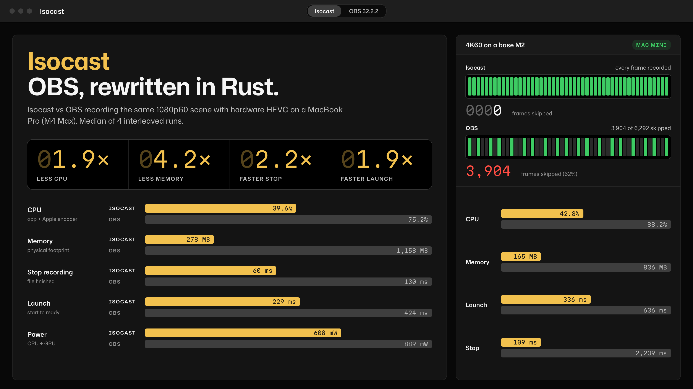
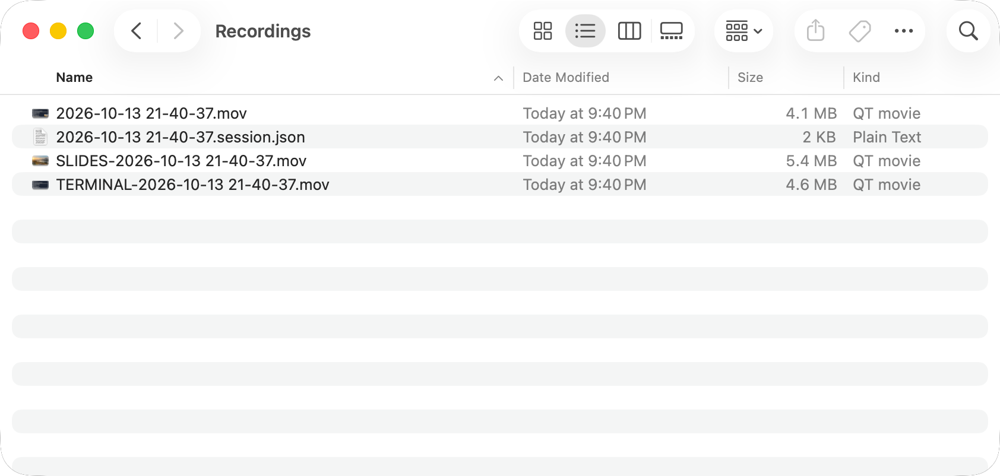
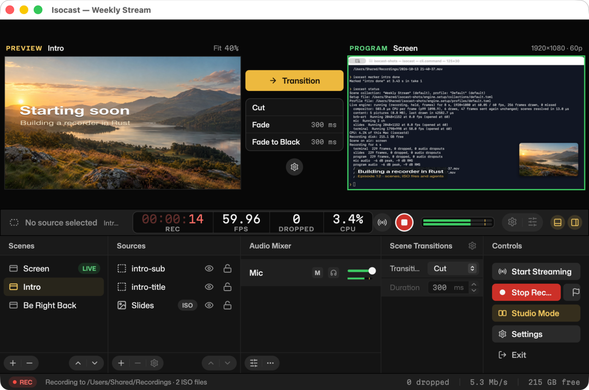
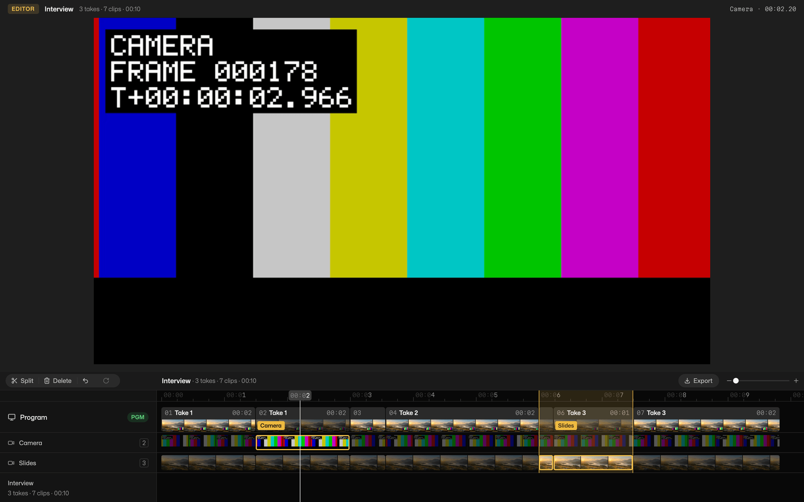
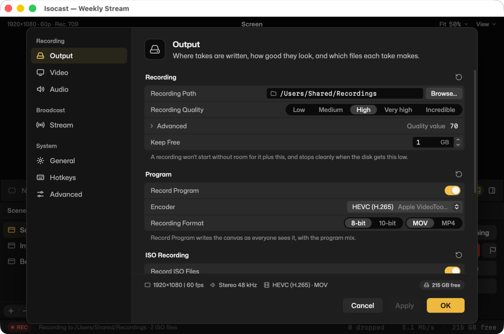
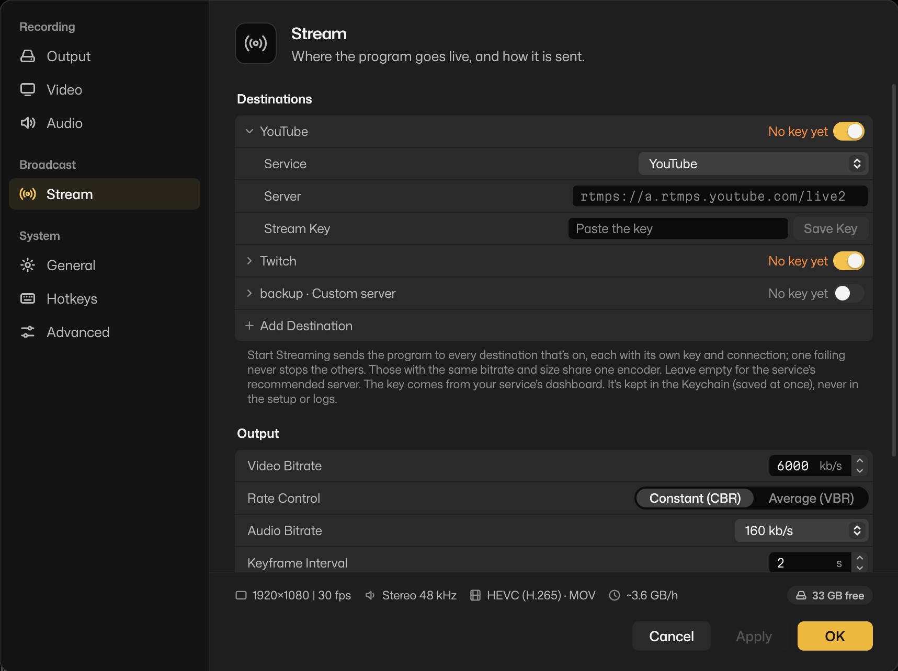
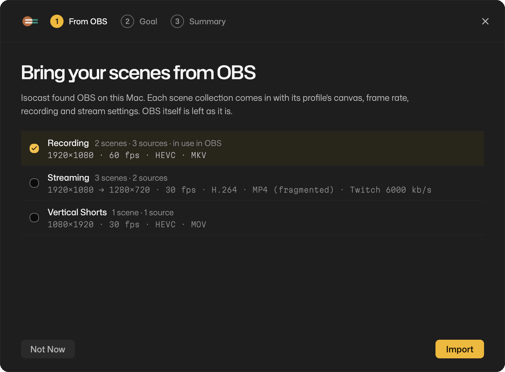
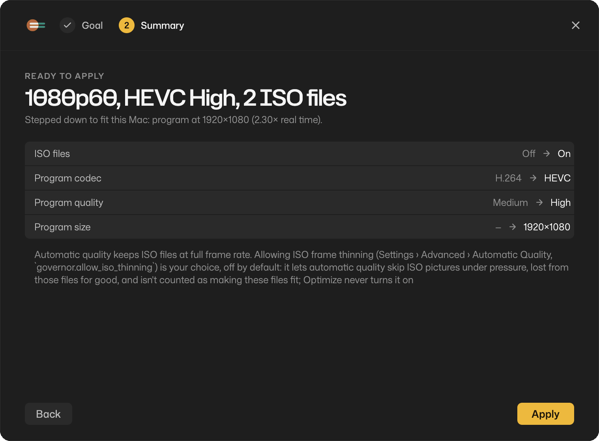
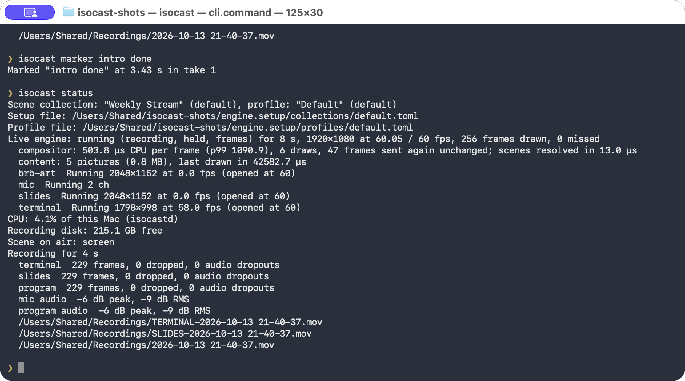

# Isocast

**A free, open-source OBS alternative for Mac that records every source as its own file.**

Isocast is a screen recorder and streaming app for macOS on Apple silicon.
It works like OBS, with scenes, sources, transitions and an audio mixer,
and it also saves each screen, window and camera as a separate
full-quality file (ISO recording), all on one clock. It uses about half
the CPU of OBS for the same recording, imports your OBS scene
collections, and answers the obs-websocket tools you already use. Written
in Rust, MIT or Apache 2.0.
[isocast.xyz](https://isocast.xyz)

[Download for Mac](https://github.com/R44VC0RP/isocast/releases) ·
[Getting started](docs/getting-started.md) ·
[Isocast vs OBS](#isocast-vs-obs) · [FAQ](#faq)

## Why switch from OBS

- **Every source in its own file.** Fix a shot in your editor without
  re-recording: the program video plus one file per screen, window and
  camera, lined up by a session file. No plugin, no syncing by hand.
- **Lighter on your Mac.** In our benchmarks Isocast used 25–29% of a core
  where OBS used 58–71%, and 88–356 MiB of memory where OBS used
  619–1344 MiB ([how it was measured](docs/benchmarks.md)).
- **Edit what you recorded.** The editor window lays every ISO file out
  on one timeline: trim, split and switch angles, then export
  frame-accurately without re-encoding what you didn't cut.
- **Bring your OBS setup.** On first launch Isocast finds your OBS scene
  collections and profiles and imports them; anything that can't come
  over is listed with the reason. Tools that speak obs-websocket (Touch
  Portal, community Stream Deck plugins, obs-websocket scripts) work
  unchanged.
- **Scriptable.** The app, the `isocast` command and AI agents (over MCP)
  drive the same engine, so anything you can click you can automate.

## Isocast vs OBS

| | Isocast | OBS Studio |
|---|---|---|
| Price and licence | Free, MIT or Apache 2.0 | Free, GPL |
| Platforms | macOS 14+, Apple silicon | macOS, Windows, Linux |
| Scenes, sources, transitions, Studio Mode | Yes | Yes |
| Each source as its own file (ISO), on one clock | Built in | Not built in (third-party Source Record plugin) |
| CPU for the same recording ([benchmarks](docs/benchmarks.md)) | About half of OBS's | Baseline |
| Memory, 1080p60 on a base M2 | 88 MiB | 630 MiB |
| Edit the ISO files after recording | Built-in editor: trim, split, angles | No, use another editor |
| Control | App, `isocast` CLI, MCP, and obs-websocket v5 (off by default) | App, obs-websocket and scripts |
| Stream Deck | Through obs-websocket (community plugins, Touch Portal); not Elgato's official OBS actions | Official Elgato plugin |
| Replay buffer | Yes | Yes |
| Virtual camera | Yes, new in 0.0.5 | Yes, mature |
| Several stream destinations at once | Built in (RTMP/RTMPS) | Third-party plugin |
| Per-app audio | Yes (macOS 14.2+) | Yes |
| Plugins | Early ([process plugins, WebAssembly audio filters](docs/plugins.md)); no OBS plugins | Large ecosystem |
| Projectors, multiview, second canvas | Not yet | Yes |
| Track record | New, in alpha | Years of polish |

OBS is the better choice today if you need Windows or Linux, a specific
OBS plugin, projectors or multiview, Elgato's official Stream Deck
actions, or years of proven polish. Isocast is for Mac users who want
separate files per source, a lighter app, or a recorder they can script.

Isocast and OBS Studio 32.2.2 recording the same synthetic 1080p60 scene
(left: MacBook Pro, M4 Max) and 4K60 scene (right: base M2 Mac mini) with
hardware HEVC, median of 4 interleaved runs, October 2026. On the M2 4K
run, OBS reported 3,904 frames skipped; only 1,645 of 6,292 were distinct.
Synthetic sources, not real capture: see [docs/benchmarks.md](docs/benchmarks.md).

## Features

**In Isocast 0.0.5 (the current download):**

- Scenes and sources: screens, windows, cameras, microphones, desktop
  audio, one app's audio or everything but some apps (macOS 14.2+),
  pictures, videos (including WebM and MKV), text and web pages, with
  filters and an audio mixer.
- Transitions, including stingers with track mattes (WebM in VP8 or VP9,
  with transparency), and Studio Mode.
- ISO recording: any source as its own file, plus the program, with a
  `.session.json` that says where each file starts and where every scene
  switch and marker falls. Each ISO file can carry its own sound (the
  camera with the mic, the screen with desktop audio). Isocast warns
  before and during a take when this Mac can't keep up with every file,
  and suggests the closest setup that fits.
- Crash-safe takes: files are committed every half second, so a crash
  loses about 0.5 s, and they are repaired on the next launch. Pause and
  resume in the same file, and markers.
- The editor window (**Window › Editor**, ⌘E): every ISO track of your
  takes on one timeline, with trim, split, ripple delete, per-span
  angles, undo and frame-accurate export. The takes are never changed.
- **Replay buffer:** keep the last 5–300 seconds of the program in memory
  and save them with a click or a hotkey.
- **Virtual camera:** the program as a camera for Zoom, Meet, FaceTime
  and other apps, updated with the app, and **Remove Virtual Camera**
  when you're done with it.
- Streaming to Twitch, YouTube, Kick, Facebook or any RTMP/RTMPS server,
  or to several at once, each with its own key kept in your Keychain.
  Starting a stream during a recording no longer drops ISO frames.
- First launch finds your OBS scene collections and offers to import them,
  then **Optimize** picks settings this Mac can keep up with, for
  recording, streaming or both.
- obs-websocket v5 compatibility (`isocast websocket enable`), so OBS
  remotes, Touch Portal, community Stream Deck plugins and obs-websocket
  scripts (obs-cmd, obsws-python) can drive Isocast.
- Profiles and scene collections, as in OBS, global hotkeys, timelines
  (record takes in order, export one video), the `isocast` CLI and MCP
  tools for agents.
- Automatic updates. macOS prompts name the engine "Isocast Engine".

**Coming next** (not in a release yet; see [coming soon](docs/coming.md)):

- Steadier under heavy load: an engine hardening pass, one GPU device per
  app, a stream that starts cleanly on a busy Mac, and more performance
  work against OBS.
- Fixes from the 0.0.5 follow-ups: plugins, streaming, the virtual camera,
  developer mode and updates.
- Later ideas: running real OBS plugins in a helper process, Elgato
  Stream Deck's own protocol, projectors and multiview, a second
  (vertical) canvas, shader filters and WebAssembly sources.

## A closer look

**Every source in its own file.** One take: the program video, an ISO file
per source and the session file that lines them up.

**Studio Mode.** Line up the next scene in the preview while the program
stays on air, then take it live with a cut, a fade or a stinger.

**Edit every angle.** The editor window shows a track per ISO source
under the program; trim, split, pick the angle for each stretch and
export.

**Choose what gets its own file** in Settings › Output.

**Stream to several places at once.** Settings › Stream lists each
destination with its own key, on or off.

**Bring your OBS scenes:** on first launch Isocast offers the
scene collections it finds, then **Optimize** picks settings this Mac can
keep up with.

**Script it.** The `isocast` command drives the same engine as the app.

## Download

1. Get the latest **Isocast.dmg** from
   [Releases](https://github.com/R44VC0RP/isocast/releases).
2. Open it and drag Isocast to Applications.
3. Isocast updates itself: it checks daily and asks before installing, or
   use **Isocast › Check for Updates…**.

You need a Mac with Apple silicon (M1 or later) and macOS 14 Sonoma or
later. Intel Macs aren't supported.

Isocast is in alpha: expect rough edges, and keep a backup recorder for
anything you can't redo.

## First steps

1. **Open Isocast and allow access.** The permissions step asks for
   screen recording, camera and microphone access; macOS may ask you to
   reopen Isocast after granting screen recording.
2. **Pick a start.** *Start with this Mac* builds ready-made scenes from
   your screen, camera and microphone. *Import from OBS* brings an OBS
   scene collection over.
3. **Record.** Press **Start Recording**, then **Stop**. **File › Show
   Recordings** opens the folder.

More in [Getting started](docs/getting-started.md).

## FAQ

**Can I import my OBS scenes?**
Yes. *Import from OBS* (or `isocast setup import-obs`) reads OBS scene
collections and profiles from `~/Library/Application Support/obs-studio`
or an exported `.json`, and lists anything without an Isocast equivalent.
The [OBS parity table](docs/obs-parity.md) shows how each OBS source,
filter and transition maps.

**Does it work with my Stream Deck?**
Through obs-websocket. Run `isocast websocket enable`; it prints the
address (`ws://127.0.0.1:4455`) and a password once. Enter both in the
tool's OBS WebSocket settings: Touch Portal, Streamer.bot, Bitfocus
Companion, community Stream Deck plugins that use obs-websocket, or
scripts like obs-cmd. Elgato's official Stream Deck OBS actions use their
own OBS plugin rather than obs-websocket, so they don't connect.

**Does it support stingers and WebM?**
Yes: stinger transitions with track mattes, and WebM (VP8 or VP9, with
transparency) and MKV files in media sources and stingers, so older OBS
stingers in VP8 work too. Stinger audio isn't played yet.

**Can I edit in Isocast?**
Yes, the basics. Record takes into a [timeline](docs/timelines.md), then
open the editor (**Window › Editor**, ⌘E) to trim, split, delete spans and
choose which ISO angle shows when. Export is frame-accurate and copies
the video as recorded except near a cut; the original files are never
changed. For effects, colour and titles, open the ISO files in your usual
editor.

**Can it stream to Twitch or YouTube?**
Yes: Twitch, YouTube, Kick, Facebook or any RTMP/RTMPS server, or
several at once, while recording if you like. See [Streaming](docs/streaming.md).

**Where do my recordings go?**
To `~/Movies/Isocast` unless you choose another folder in Settings ›
Output, one folder per recording. Each take holds the program video, one
file per ISO source (`SCREEN-…`, `CAMERA-…`) and a `.session.json`.
Files are committed every half second, so a crash loses about the last
0.5 s, and Isocast repairs the files on its next launch (a power cut can
lose more; nothing is guaranteed then). [More on crash-safe
takes](docs/crash-safe-takes.md).

**Is it free? Is it open source?**
Yes and yes: free, MIT or Apache 2.0. It's a new app written in Rust, not
a fork of OBS, and no OBS code was read or copied.

**Does it work on Windows or Linux?**
Not yet. Mac first; the engine is built so other platforms can follow.

## Docs

- [Getting started](docs/getting-started.md),
  [recording](docs/recording.md), [streaming](docs/streaming.md)
- [Timelines](docs/timelines.md): record takes in order and export one video
- [Hotkeys](docs/hotkeys.md), [scenes as code](docs/scenes.md),
  [plugins](docs/plugins.md)
- References: [CLI](docs/cli.md), [setup files](docs/setup-reference.md),
  [MCP tools for agents](docs/mcp-tools.md)
- [Benchmarks against OBS](docs/benchmarks.md),
  [OBS parity](docs/obs-parity.md), [coming soon](docs/coming.md)

---

Building from source, how it works inside, and how to contribute:
[CONTRIBUTING.md](.github/CONTRIBUTING.md). Licensed under
[MIT](LICENSE-MIT) or [Apache 2.0](LICENSE-APACHE); third-party licences
are in [THIRD_PARTY_NOTICES](THIRD_PARTY_NOTICES).
