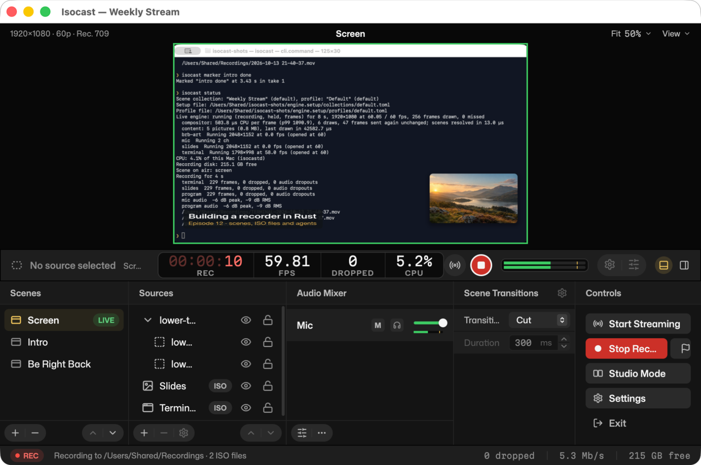

# Isocast

**Record and stream your Mac like OBS, with every source saved as its own file, at a fraction of the CPU.**

## What it does

**Scenes and sources, like OBS.** Put screens, windows, cameras, pictures,
videos, text and web pages into scenes, switch between them with
transitions, and mix your audio. Bring your OBS scene collections with you:
Isocast imports them.

**Studio Mode.** Line up the next scene in the preview while the program
stays on air, then take it live with a transition.

**Every source in its own file.** Alongside the finished video, Isocast can
save each screen, window and camera as a separate full-quality file (an ISO
recording), all lined up on one clock. Fix a shot in your editor later
without re-recording, and without syncing anything by hand.

**Settings that make sense.** Choose where takes go and how good they look,
which sources get their own file, and where to stream (Twitch, YouTube,
Kick, Facebook or any RTMP server). Stream keys stay in your Keychain.

**Control it from anywhere.** The app, the `isocast` command and AI agents
(over MCP) all drive the same engine, so you can script a show, switch
scenes from a Stream Deck-style plugin, or ask an agent to set up and check
a recording.

## Fast and light

Isocast and OBS Studio 32.2.2 recording the same synthetic 1080p60 scene
(left: MacBook Pro, M4 Max) and 4K60 scene (right: base M2 Mac mini) with
hardware HEVC, median of 4 interleaved runs, October 2026. On the M2 4K
run, OBS reported 3,904 frames skipped; only 1,645 of 6,292 were distinct.
How it was measured: [docs/benchmarks.md](docs/benchmarks.md).

## Download

Get the latest **Isocast.dmg** from
[Releases](https://github.com/R44VC0RP/isocast/releases), open it and drag
Isocast to your Applications folder.

You need:

- a Mac with Apple silicon (M1 or later; Intel Macs aren't supported);
- macOS 14 Sonoma or later.

Isocast is in alpha: expect rough edges, and keep a backup recorder for
anything you can't redo.

## First steps

1. **Open Isocast.** Choose *Start with this Mac* to get ready-made scenes
   from your screen, camera and microphone, or *Import from OBS*.
2. **Allow access.** macOS asks for screen recording, camera and microphone
   access the first time. Turn them on in System Settings → Privacy &
   Security, then reopen Isocast if it asks.
3. **Record.** Press **Start Recording**, and **Stop Recording** when you're
   done. **File → Show Recordings** opens the folder.

More in [Getting started](docs/getting-started.md).

## FAQ

**How is it different from OBS?**
Isocast is a new app written in Rust, not a fork. It saves every source as
its own file as well as the finished video, it uses much less CPU and memory
for the same recording, and everything it does can be driven by the
`isocast` command or an AI agent, not just the window. OBS does far more
today (plugins, platforms, years of polish). Isocast was written clean-room:
no OBS code was read or copied.

**Where do my recordings go?**
To `~/Movies/Isocast` unless you choose another folder in Settings → Output.
Each take is the finished video (`2026-10-13 21-40-37.mov`), one file per
ISO source (`SCREEN-…`, `CAMERA-…`) and a `.session.json` that says where
each file starts. Files are written in fragments, so even a crash leaves
them playable.

**Is it free? Is it open source?**
Yes and yes: free, and open source under the MIT or Apache 2.0 licence.

**Does it work on Windows or Linux?**
Not yet. Mac first; the engine is built so other platforms can follow.

## Docs

- [Getting started](docs/getting-started.md)
- [Recording](docs/recording.md) and [streaming](docs/streaming.md)
- [Timelines](docs/timelines.md): record takes in order and export one video
- [Scenes as code](docs/scenes.md), [plugins](docs/plugins.md)
- References: [CLI](docs/cli.md), [setup files](docs/setup-reference.md),
  [MCP tools for agents](docs/mcp-tools.md)
- [Coming soon](docs/coming.md): hotkeys, the virtual camera and more

---

Building from source, how it works inside, and how to contribute:
[CONTRIBUTING.md](.github/CONTRIBUTING.md). Licensed under
[MIT](LICENSE-MIT) or [Apache 2.0](LICENSE-APACHE); third-party licences
are in [THIRD_PARTY_NOTICES](THIRD_PARTY_NOTICES).
